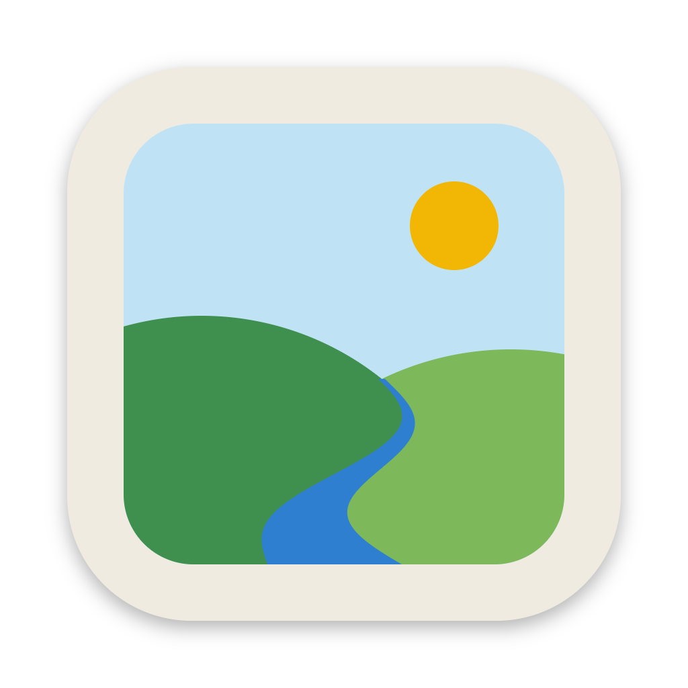

<p align="center"></p>

# nanoview

A small, fast image viewer in the style of [qView](https://interversehq.com/qview/), written in
Zig on [nanoui](https://github.com/justrach/nanoui). It opens a picture and lets you step
through its folder in the same order your file manager shows it.

macOS first; Linux and Windows builds come from the same code.

## Install

Download an archive from the [releases page](https://github.com/jeiang/nanoview/releases).
The macOS app is signed with a Developer ID and notarized, so it opens without a Gatekeeper
warning.
The Linux archive holds `bin/` and `share/` (a desktop entry and the icon); unpack it over a
prefix, for example `tar -xzf nanoview-*.tar.gz -C ~/.local`.

With Nix:

```sh
nix run github:jeiang/nanoview -- picture.jpg
```

## Use

Open a picture, a folder or several pictures from the command line, with Cmd/Ctrl+O, by
dropping them on the window, or with Finder's "Open With". A folder shows its first picture.
Several pictures from one folder limit the list to those pictures until the next open.

| Key | Action |
|---|---|
| Left, Right, Space, Shift+Space | Previous, next picture in the folder |
| Mouse Back, Forward | Previous, next picture |
| Home, End | First, last picture |
| `x` | Random picture |
| F5, Cmd/Ctrl+Shift+R | Reload the file and its folder |
| `s` | Start or stop the slideshow |
| `k`, `.` | Pause or resume an animation; show its next frame |
| `[`, `]` | Animation speed down, up, in steps of 25 % from 25 % to 400 % |
| Alt+Down, Alt+Up | Next, previous page of a multi-page picture |
| Wheel, pinch, `+`, `-` | Zoom, down to 10 % and up to 3200 % |
| Drag, trackpad scroll | Pan |
| `0`, `1`, double click | Fit, 100 %, toggle |
| `w` | Fit mode: whole, width, height, fill |
| `u` | Let fit enlarge small pictures |
| `p` | Smooth or sharp pixels above 100 % |
| `z` | Zoom lock: the next picture keeps the zoom and position |
| `b` | Checkerboard behind the picture |
| `r`, `l` | Rotate right, left |
| `m`, `v` | Mirror, flip |
| `i` | Show name, size, zoom, position, format, file size and date |
| `e` | Show EXIF details: camera, lens, date, exposure, GPS, color profile |
| `f`, Escape | Full screen, leave full screen |
| Cmd+Backspace, Forward Delete | Move to Trash |
| Cmd/Ctrl+Z | Put back the last picture moved to the Trash (not on Windows) |
| F2 | Rename: Enter renames, Escape cancels; an existing file is never replaced |
| Cmd/Ctrl+C | Copy the picture at full size; on macOS and Windows the file goes with it |
| Cmd/Ctrl+V | Open copied files, or show a copied picture |
| `t` | Keep the window above others |
| Cmd/Ctrl+R | Reveal in file manager, with the file selected |
| Cmd/Ctrl+Shift+C | Copy path |
| Cmd/Ctrl+Shift+S | Save the shown frame or page as PNG, at full size and unrotated |

Rotation, mirror and flip change the view only: nothing is written to disk. The folder is read
again before a step when it changed on disk. A command that fails says so in the window.
Put back remembers up to 16 pictures trashed since the program started. A pasted picture is
shown as "Clipboard": it is not a file, so the step keys do nothing, and trash, reveal and
rename say so.

### Formats

PNG, JPEG, GIF, BMP, QOI, TGA and WebP open on every system: nanoview carries decoders for
them ([Wuffs](https://github.com/google/wuffs) and
[libwebp](https://chromium.googlesource.com/webm/libwebp)). The system's decoder is tried
first and adds more:

- macOS (ImageIO): HEIC, AVIF, TIFF, ICO, JPEG 2000, PSD, ICNS, OpenEXR, SGI, PBM, JPEG XL,
  MPO (first picture), PICT, and camera RAW as DNG, Canon CR3, Panasonic RW2, Leica RWL,
  Hasselblad 3FR and FFF, Sony ARW, SR2 and SRF, Nikon NEF and NRW, Pentax PEF and Epson ERF.
  Other camera RAW formats are not listed: only their small embedded preview would show.
- Linux: with gdk-pixbuf 2 (`libgdk_pixbuf-2.0.so.0`) installed, what its loaders read from
  this set: AVIF, HEIC, TIFF, ICO, JPEG XL, JPEG 2000, ICNS, PNM, PCX, XBM and XPM.
- Windows (WIC): what the installed decoders list at startup from this set: TIFF, ICO, DDS,
  JPEG XR, and HEIC, AVIF and JPEG XL with the matching codec from the Microsoft Store.

A picture is known by its content: a file with a wrong or missing extension opens when you
choose it, and the info line names its real format. A folder is still listed by extension.

Colors: macOS converts every picture to sRGB. Windows converts pictures with an embedded
color profile. Linux shows the stored values.

Animated GIF, APNG and WebP play on every system. A frame delay under 20 ms plays as 100 ms,
and the file's loop count is kept. An animation over 16 megapixels shows its first frame.
Multi-page TIFF, multi-size ICO and similar files turn pages on macOS and Windows; Linux shows
the first page, because gdk-pixbuf cannot choose one.

Linux needs GTK 3 or 4 and OpenGL. The licenses of the bundled code are in
`share/licenses/nanoview` (in `Resources/licenses` inside the macOS app, in `licenses` beside
the Windows program).

### Settings

nanoview reads `settings.conf` once at startup and never writes it. A missing file means the
defaults.

- macOS: `~/Library/Application Support/nanoview/settings.conf`
- Linux: `$XDG_CONFIG_HOME/nanoview/settings.conf` (default `~/.config/nanoview/`)
- Windows: `%APPDATA%\nanoview\settings.conf`

One `key = value` per line; `#` starts a comment. A line that cannot be used keeps its default,
and the window names the first such line.

| Key | Default | Values |
|---|---|---|
| `fit_mode` | `whole` | `whole`, `width`, `height`, `fill` |
| `fit_upscale` | `false` | `true`, `false` |
| `smooth` | `true` | `true`, `false` |
| `zoom_lock` | `false` | `true`, `false` |
| `checkerboard` | `false` | `true`, `false` |
| `zoom_step_percent` | `25` | 1 to 400 |
| `loop` | `true` | `true`, `false`: step from the last picture to the first |
| `slideshow_seconds` | `5` | 1 to 3600 |
| `slideshow_reverse` | `false` | `true`, `false` |
| `trash_confirm` | `false` | `true`, `false`: ask before Move to Trash |
| `after_trash` | `next` | `next`, `previous` |
| `background` | `theme` | `theme` or `#rrggbb`: the color behind the picture |
| `window_fit` | `always` | `always`, `first`, `never`: when the window takes the picture's size |
| `window_min_percent` | `0` | 0 to 100: smallest window, as a share of the screen |
| `window_max_percent` | `80` | 10 to 100: largest window, as a share of the screen |
| `sort` | `system` | `system`, `name`, `kind`, `size`, `date_modified`, `date_created`, `random` |
| `sort_descending` | `false` | `true`, `false`: no effect with `system` or `random` |
| `title` | `name` | `name`, `name_position`, `full`, `none`: the window title |
| `title_bar` | `default` | `default`, `hidden`: Windows only |
| `always_on_top` | `false` | `true`, `false`: no effect on GTK 4 |
| `recent` | `true` | `true`, `false`: remember the last 10 opened files and folders |
| `single_instance` | `false` | `true`, `false`: a second start hands its files to the open window |
| `animation` | `true` | `true`, `false`: `false` shows the first frame of an animation |

`sort = system` follows Finder or Explorer. `date_created` exists on macOS only; elsewhere it
sorts by the modified date and says so. `random` shuffles again on every folder read. The
window is never smaller than 320 by 240.

A `key.<action> = <keys>` line replaces an action's keys, for example
`key.next = n, PageDown`; an empty value removes them. Keys are separated by commas.
Modifiers are `cmd` (Control off macOS), `ctrl`, `alt` and `shift`, joined with `+`. Named
keys are `space`, `enter`, `escape`, `tab`, `backspace`, `delete`, `left`, `right`, `up`,
`down`, `home`, `end`, `pageup`, `pagedown` and `F1` to `F12`; any other single character is
itself. `#` and `,` cannot be bound. The action names are those in
[`src/actions.zig`](src/actions.zig), such as `next`, `zoom_in` and `full_screen`. When a key
is given to two actions, the later line wins and the window names it.

The recent list is a text file, one path per line, newest first: `recent` beside
`settings.conf` on macOS, `$XDG_STATE_HOME/nanoview/recent` (default `~/.local/state/`) on
Linux and `%LOCALAPPDATA%\nanoview\recent` on Windows.

### Linux and Windows

These builds are compiled and unit-tested from macOS but have not been run on those systems
yet. On Linux, Move to Trash follows the FreeDesktop.org Trash specification; on Windows it
uses the Recycle Bin. On Windows, Ctrl+wheel zooms continuously, the same as a touchpad pinch.

## Build

Requires Zig 0.17.1; the Nix devshell provides it.

```sh
nix develop
zig build run -- picture.jpg   # run
zig build test                 # tests
zig build app                  # zig-out/nanoview.app (macOS)
```

See [AGENTS.md](AGENTS.md) for the code layout and conventions, and
[CHANGELOG.md](CHANGELOG.md) for changes.
